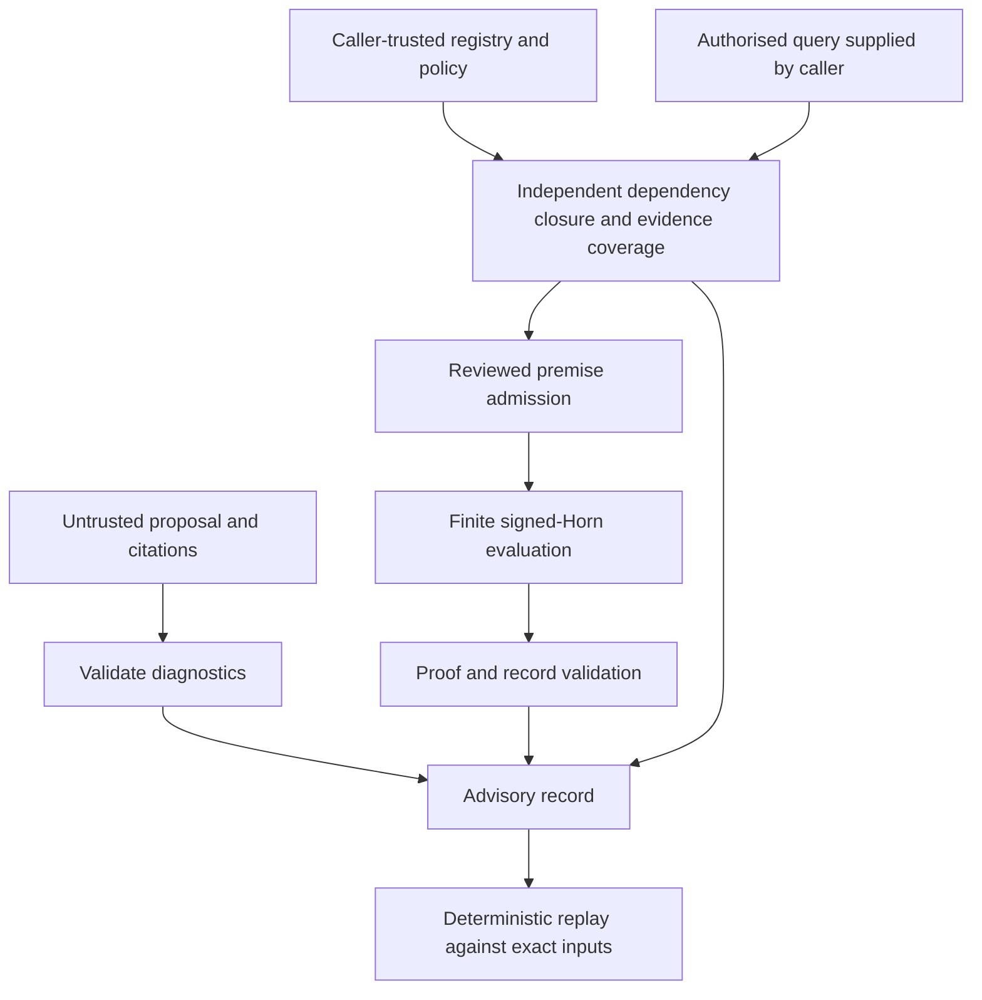

# SAGE-Judge

**Evidence-grounded adjudication and verifiable formal reasoning for AI systems.**

Separate an AI proposal from the evidence it cites, the premises that are admitted, the conclusion that follows, and the advisory policy that acts on that conclusion.

Experimental reference framework · Python 3.11+ · Standard library only · No model or network service required.

> v0.1.0 experimental release. Not a production decision system.

Licence: [MIT](LICENSE).

## Quickstart

From the source checkout, using Python 3.11 or newer (POSIX shell):

```sh
PYTHONPATH=src python -m sage_judge --version
PYTHONPATH=src python -m sage_judge demo --case inspection_conflict
PYTHONPATH=src python -m unittest discover -s tests -v
```

The conflicting synthetic records produce `proof_posture: BOTH`, `business_verdict: REVIEW`, and `execution_authority: NONE`, even when the untrusted proposal omits the contradictory citation.

## Architecture



- **Evidence admission:** bind pre-reviewed mappings to exact source bytes, revisions, spans, scope, polarity and applicable completeness witnesses.
- **Coverage:** recompute expected mappings for reachable dependencies; model-selected citations do not choose premises. Incomplete coverage requires review.
- **Formal reasoning:** four postures — `SUPPORTED`, `REFUTED`, `BOTH`, `UNKNOWN`. Missing evidence is not automatically negative evidence.
- **Verification:** check proof witnesses and replay the full record against the same trusted inputs. Hashes bind content, not the identity or truth of its author.
- **Advisory policy:** separate from proof posture; model `ABSTAIN` or `REVIEW` caps the recommendation at review. Execution authority is always `NONE`.

## Try the boundaries

| Demo | Expected outcome |
|---|---|
| `inspection_positive` | SUPPORTED / KEEP |
| `inspection_unknown` | UNKNOWN / REVIEW |
| `inspection_conflict` | BOTH / REVIEW despite omitted citations |
| `unsupported_dependency` | Typed refusal; no decision |

Use `PYTHONPATH=src python -m sage_judge demo --case NAME`. The last demo is expected to exit 2. See [Quickstart](docs/QUICKSTART.md) for API, installation and replay examples.

## What this does not do

SAGE-Judge does not translate natural language into correct formal facts. It requires independently reviewed mappings and a caller-established trust root. It does not establish real-world evidence completeness, source authenticity, population accuracy, scientific superiority, production security or safe downstream action. Its qualified API fragment requires reachable rule bodies to preserve the exact ordered query argument tuple; unsupported dependencies fail closed. See [Limitations](docs/LIMITATIONS.md) and [Threat model](docs/THREAT_MODEL.md).

## Explore the implementation

[Architecture](docs/ARCHITECTURE.md) · [API contract](docs/API_CONTRACT.md) · [Schemas](docs/SCHEMA_REFERENCE.md) · [Error catalogue](docs/ERROR_CATALOGUE.md) · [Extend a domain](docs/EXTENDING_DOMAINS.md) · [Reproducibility](docs/REPRODUCIBILITY.md) · [Provenance](docs/PROVENANCE.md)

The inherited standalone suite exercises 12 authored scenarios across equipment inspection and training-certificate validity plus additional adversarial mechanics. These are synthetic controlled checks, not independent semantic benchmarks.
